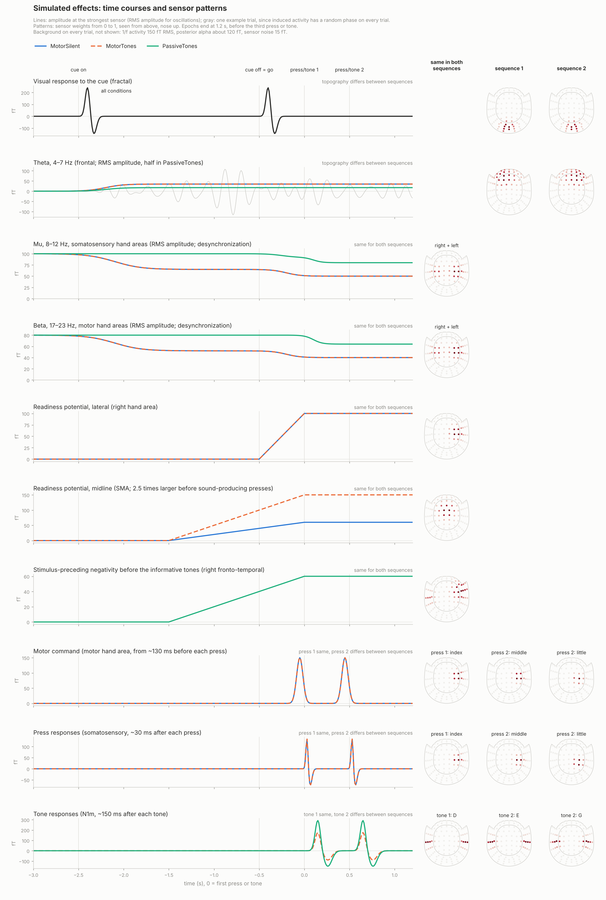
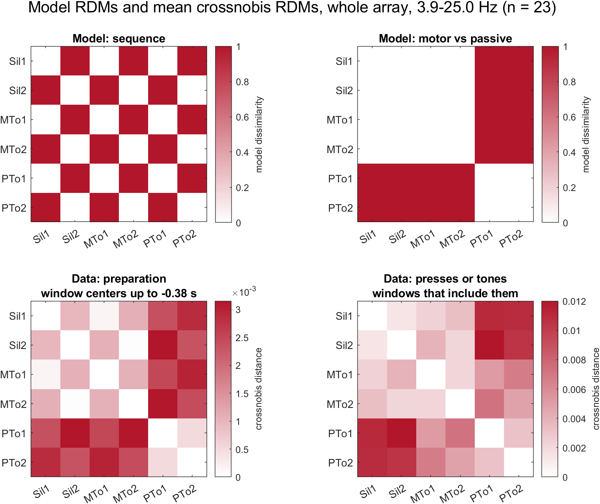
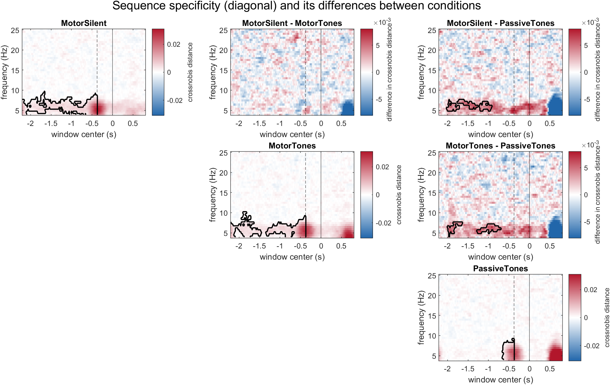
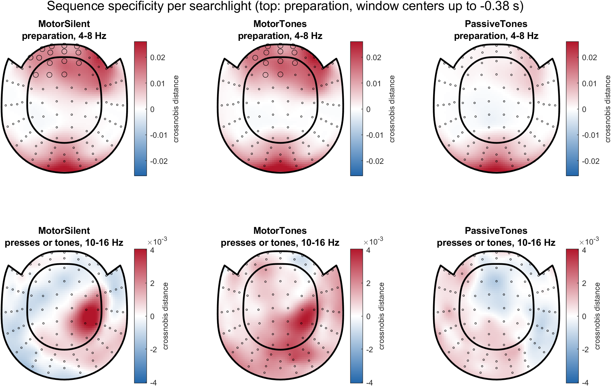
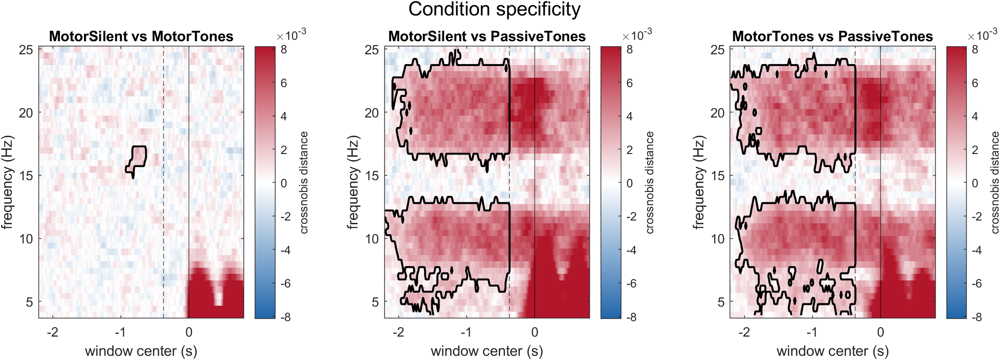
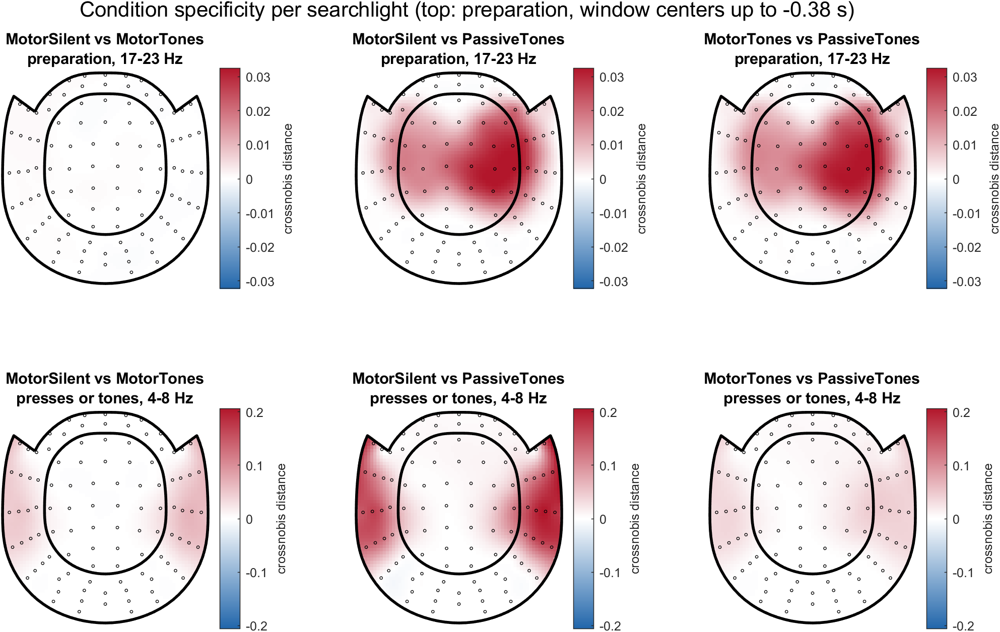

# Time-frequency RSA of MEG sequence preparation

A MATLAB/FieldTrip pipeline that analyzes brain (magnetoencephalography; MEG) activity, detecting at every time point and frequency representations of finger sequences and melodies, even before the start of the sequence.

The analysis is based on an experiment reported in a [bioRxiv preprint](https://biorxiv.org/lookup/doi/10.64898/2026.03.27.714833). Human participants learned to play two melodies on a keyboard, each melody being 5-notes long and isochronous. During the MEG session, they executed those melodies on the keyboard from memory either silently (sound turned off) or with normal auditory feedback. In a different task, they passively listened to the melodies without any movement.

The real recordings cannot be shared, so the repository runs on **simulated data with a known ground truth**: `simulate_data.m` writes epochs in the format of the real data, with effects placed where my hypotheses put them, and `run_decoding.m` detects those effects.

**Methods:** MEG time-frequency analysis · representational similarity analysis (RSA) · cross-validated Mahalanobis (crossnobis) distance with noise whitening · repeated stratified cross-validation · sensor searchlights · cluster-based permutation tests · validation against simulated ground truth

| File | What it does |
|---|---|
| [`simulate_data.m`](simulate_data.m) | Writes simulated epochs for 23 participants (102 magnetometers; 3 conditions × 2 sequences × 60 trials) and a record of what was injected |
| [`run_decoding.m`](run_decoding.m) | Time-frequency decomposition, crossnobis RDMs per participant, RDM metrics, group cluster statistics, figures |
| [`figures/`](figures/) | Overview of the simulated effects, and the figures of `run_decoding.m` on the simulated data |

## The question

The simulated experiment follows the structure of the real one. On each trial a visual cue (a fractal) announces one of two left-hand finger sequences. When the cue disappears (the go signal), participants either

- **MotorSilent**: play the sequence on silent keys,
- **MotorTones**: play it, each key producing its own tone, or
- **PassiveTones**: listen to the tone sequence and judge whether it matches the cue.

Both sequences start with the same finger and differ from the second press on. Three questions follow:

1. **Sequence specificity.** Is the upcoming sequence represented during preparation, before the first press or tone? Since sequences start with the same finger/tone, sequence specificity during preparation must reflect a sequence-specific code and not just preparation of the first item.
2. **Condition specificity.** How different is the activity of the three conditions?
3. **Generalization.** Do the conditions share one code for each sequence?

## How the analysis works

1. **Time-frequency power.** Epochs from 2.6 s before to 1.2 s after the first press or tone; Hann-tapered sliding windows of 0.75 s (4–25 Hz, 20 ms steps); log power.
2. **Classes.** Each trial belongs to one of six classes: 3 conditions × 2 sequences.
3. **Whitening.** The trial-to-trial covariance of the channels, pooled over classes and time-frequency bins and slightly regularized, whitens every channel set: each 7-sensor searchlight and the whole array. Distances are then in units of noise.
4. **Crossnobis distances.** For each pair of classes, the whitened difference of their mean patterns is estimated in independent folds of a repeated, stratified 5-fold split. Multiplying estimates from *different* folds gives a distance whose noise cancels on average, so it is zero when two classes do not differ (Walther et al., 2016). Result: a 6 × 6 representational dissimilarity matrix (RDM) per participant, time, frequency and channel set, divided by the number of sensors so that searchlights and the whole array share a scale.
5. **RDM metrics.**
    - *Sequence specificity*: distance between the two sequences within a condition.
    - *Condition specificity*: distance between two conditions for the same sequence, averaged over the two sequences.
    - *Generalization*: distance between different sequences minus distance between the same sequence, across two conditions. Above zero when the two conditions share a sequence code.

   These metrics are contrasts between cells of the RDM. The classical alternative is to fit model RDMs to the data RDM by regression, so that each model's weight is estimated while the other models account for their share. The RDM figure below shows a sequence model and a condition model next to the data.
6. **Group statistics.** Cluster-based permutation tests across participants (Maris & Oostenveld, 2007), restricted to windows that end before the first press or tone, taking into account the time-frequency analysis window lengths, so that the preparation period is not contaminated by activity after it. Metrics are tested against zero over time × frequency (whole array) and, for sequence specificity, over sensors × time × frequency (searchlights); sequence specificity is also compared between conditions.

## Validation on simulated data

Every simulated effect: its time course at the strongest sensor (left) and its sensor pattern (right; the same in both sequences, or one per sequence). Background activity is added on every trial.

Each effect is a sensor pattern (a cluster of weights on the sensor layout) multiplied by a time course per trial. This is deliberately not a physical forward model and does not intend to mimic the MEG field orientations: the simulated data only need spatially organized effects with a known location, timing and dependence on sequence and condition, so that the output of the analysis can be checked against them. Effect strengths and source positions vary between participants, and component amplitudes vary from trial to trial.

<b>What is simulated, and why</b>

| Effect | Sensors | Timing | Differs between sequences | Conditions | Basis |
|---|---|---|---|---|---|
| Visual response to the cue | occipital | cue onset and offset | slightly: each sequence has its own fractal | all | a confound the analysis must separate by topography |
| Theta, 4–7 Hz | frontal, a different left/right mix per sequence | from cue onset to the end of the epoch | yes | all; half amplitude in PassiveTones | the hypothesis: sequence-specific preparation (see Limitations) |
| Mu, 8–12 Hz, desynchronization | somatosensory hand areas, right > left | motor: most of it during planning, full into the presses; PassiveTones: weaker, from the go signal and during the tones | no | all | Salmelin et al., 1995; Bedford et al., 2025 |
| Beta, 17–23 Hz, desynchronization | motor hand areas, right > left | motor: as mu; PassiveTones: weaker, from the first tone | no | all | Salmelin et al., 1995; Fujioka et al., 2012 |
| Readiness potential, midline | SMA | from 1.5 s before the first press; 2.5 times larger before sound-producing presses | no | MotorSilent, MotorTones | Brunia et al., 2012; Reznik et al., 2018 |
| Readiness potential, lateral | right hand area | from the go signal | no | MotorSilent, MotorTones | Brunia et al., 2012; Reznik et al., 2018 |
| Stimulus-preceding negativity | right fronto-temporal and auditory | from 1.5 s before the first tone | no | PassiveTones | Brunia et al., 2012 |
| Motor command | motor hand area, one pattern per finger, somatotopically organized | from ~130 ms before each press | from press 2 | MotorSilent, MotorTones | Brunia et al., 2012; finger order: Dechent & Frahm, 2003 |
| Press response | somatosensory hand area, one pattern per finger, somatotopically organized | ~30 ms after each press | from press 2 | MotorSilent, MotorTones | finger order: van Westen et al., 2004 |
| Tone response (N1m) | bilateral auditory, one pattern per pitch, tonotopically organized | ~150 ms after each tone; attenuated for self-generated tones | from tone 2 | MotorTones, PassiveTones | pitch order: Pantev et al., 1996; attenuation: Martikainen et al., 2005 |
| Background | 1/f activity from 30 random clusters, posterior alpha, sensor noise | throughout | no | all | |

The epochs end before the third press or tone, as in the real data; slow potentials and desynchronization therefore hold to the end of the epoch.

<b>How the amplitudes and the noise were chosen</b>

The amplitudes are plausible guesses, not calibrated to a dataset: round numbers in a typical range for magnetometers. What matters for the analysis is their ratios, not their absolute values: the features are log power and the distances are computed after whitening, so scaling every amplitude and the noise by the same factor leaves every distance unchanged.

The ratios follow three rules:

- **The background makes single trials noisy, as in real recordings.** 1/f activity from 30 randomly placed clusters (150 fT RMS), posterior alpha whose amplitude varies from trial to trial (~120 fT), and white sensor noise (15 fT, about 2 fT/√Hz). Before the cue, this gives about 145 fT RMS at a typical sensor and about 220 fT over the alpha source.
- **Sensory responses are the largest, motor fields and slow potentials smaller.** Relative to the trial-to-trial noise at each response's best sensor, a single-trial N1m is about 2 times the noise; the visual responses about 1 time, as they sit where the posterior alpha is strongest; motor fields and readiness potentials 0.75 to 1.3 times; the stimulus-preceding negativity about 0.5 times.
- **The effects of interest are weak on single trials and emerge across trials and participants.** Motor preparation, which separates the motor conditions from PassiveTones, is the stronger of the two: before the first press, the whole-array distance between a motor condition and PassiveTones is about twice the distance between the two sequences within a motor condition. The theta difference between the two sequences has a single-trial effect size (Cohen's d of log power, frontal sensors, preparation window) of about 0.5 in the motor conditions in the median participant, from 0.1 to 1.9 across participants, and about 0.1 in PassiveTones.

Measured on the simulated data of the second run (see below): the background and the evoked responses on 8 participants, the theta effect size and the distances on all 23.

Effect strengths vary between participants (log-normal, about ±30%), as do the noise level (±15%) and the source positions (a few mm); amplitudes vary by about ±25% from trial to trial.

### What the analysis recovers

| Simulated | Expected in the analysis | Recovered |
|---|---|---|
| Sequence-specific frontal theta in every condition | Sequence specificity during preparation, theta band, frontal searchlights, in every condition | Motor conditions: yes, about 4–10 Hz throughout preparation, at frontal searchlights. PassiveTones, at half amplitude: no; its only cluster before the first tone comes from the cue offset (see below) |
| Sequence-specific visual responses to the cue | Sequence specificity around cue onset and offset, occipital searchlights | Yes: sequence specificity peaks in the windows that contain the cue onset or offset, with an occipital maximum in the searchlight maps of every condition |
| Theta at half amplitude in PassiveTones | Lower sequence specificity in PassiveTones than in the motor conditions; no difference between the two motor conditions | Yes: lower than in MotorSilent and than in MotorTones (about 5–7.5 Hz, between −2.0 and −0.8 s); no difference between the motor conditions |
| The same theta and visual patterns in every condition | Generalization for every pair of conditions | MotorSilent and MotorTones: yes, about 4–9 Hz throughout preparation. With PassiveTones: only in the windows that contain the cue onset or offset (see below) |
| Mu and beta desynchronization during planning, motor conditions only; weaker theta in PassiveTones | Condition specificity between the motor conditions and PassiveTones, in the mu, beta and theta bands | Yes, for both motor conditions: one cluster at about 4–13 Hz (theta and mu) and one at about 16–24 Hz (beta), throughout preparation |
| No difference between MotorSilent and MotorTones at 4–25 Hz before the first press (only the slow midline readiness potential differs, below the analyzed band) | No condition specificity between them | Yes, apart from one small cluster at 15–17 Hz around −0.8 s: a false positive, since nothing differs there. A cluster test of an absent effect finds one 5% of the time |

All clusters are significant at α = 0.05 (cluster level, 1000 permutations). Times are the centers of the 0.75 s analysis windows, which span 0.375 s on either side: the first tested window (−2.2 s) already contains the cue onset (−2.5 s), and windows centered after about −0.9 s contain the cue offset (−0.5 s).

**A second run** of the whole pipeline, with a different noise draw (Octave instead of MATLAB, 500 permutations), finds the same effects, with two differences at the edge of detection: there, generalization with PassiveTones is significant throughout preparation, and there is no false-positive cluster.

## Results on the simulated data

23 simulated participants; 5 cross-validation repetitions (the default in `run_decoding.m` is 50) and 1000 permutations per test.

Top: two model RDMs, what the data would look like if only the sequence mattered (left) or only motor vs passive (right). Bottom: the mean crossnobis RDMs over the whole sensor array, 4–25 Hz. Before the first press or tone (left), motor vs passive dominates: the PassiveTones classes are far from the four motor classes, the two sequences differ less within each condition, and MotorSilent and MotorTones overlap for the same sequence. Afterwards (right), presses and tones dominate: MotorSilent, with presses but no tones, is furthest from PassiveTones, and MotorTones, with both, lies in between.

Sequence specificity per condition (diagonal) and its differences between conditions (upper panels), whole array. Outlined: significant clusters, tested before the first press or tone only (left of the dashed line). In the motor conditions, sequence specificity is significant throughout preparation; in PassiveTones, only in the last windows, which contain the visual response to the cue offset. It is higher in each motor condition than in PassiveTones, and the same in the two motor conditions. After the first press or tone (not tested), the second press or tone adds sequence information, most in PassiveTones.

Sequence specificity per searchlight. Top: preparation, 4–8 Hz: a frontal maximum in the motor conditions (theta) and an occipital maximum in every condition (visual responses to the cue); marked: sensors where the significant cluster covers at least half of the plotted time-frequency bins. Bottom: windows that include the presses or tones, 10–16 Hz: the second finger over the right hand area, in the motor conditions.

Condition specificity, whole array. Before the first press or tone, both motor conditions differ from PassiveTones throughout preparation, in theta and mu (about 4–13 Hz) and in beta (about 16–24 Hz); MotorSilent and MotorTones differ only in one small cluster, a false positive (see the table above). After it (not tested), every pair differs at 4–8 Hz, where the responses to presses and tones are.

Condition specificity per searchlight. Top: preparation, 17–23 Hz: beta desynchronization over the hand areas, right > left, wherever a motor condition meets PassiveTones; nothing between the two motor conditions. Bottom: windows that include the presses or tones, 4–8 Hz: bilateral auditory sensors, most between MotorSilent and PassiveTones (presses without tones vs tones at full strength), least between the two tone conditions (whose tones differ only in strength, as self-generated tones are attenuated).

Also in [`figures/`](figures/): generalization of the sequence code across conditions (`sequence_generalization.png`).

## How to run

Requirements: MATLAB R2020a or newer and [FieldTrip](https://www.fieldtriptoolbox.org/) (the scripts are set up for the 2024-05-15 release).

1. In `simulate_data.m`, set the FieldTrip path and `outputDir`, then run it. It writes one file per participant (about 150 MB each) and `simulation_truth.mat`.
2. In `run_decoding.m`, set the FieldTrip path, `megDataDir` (the simulated data) and `outputDir`, then run it: it decodes every participant (about 100 MB of results each), then computes the group statistics and saves the figures as PNG files in `outputDir`, under the names used in `figures/`. The decoding is the slow part (one time-frequency decomposition and `nReps` cross-validation repetitions per participant); set `runDecoding = false` to redo only the statistics or the figures.

Settings worth knowing: `band` (time-frequency preset: `verylow`, `low`, `high`), `nReps` (cross-validation repetitions), `nNeighbours` (searchlight size), `nRandomizations` (permutations per test).

## Limitations

- The simulated sources are clusters on the 2-D sensor layout, not dipoles in a head model, so sensor patterns are simpler than real MEG fields.
- Amplitudes and noise levels are plausible guesses (see above), not fitted to the real recordings.
- The main effect of interest, the sequence-specific theta, is motivated by evidence that theta activity carries serial order and supports the maintenance of serial order in working memory (Hsieh et al., 2011; Lisman & Jensen, 2013). Its simulated form, however (frontal topographies, timing, strength, and weaker theta in PassiveTones), is arbitrary: it was designed to illustrate what the analysis can detect, not to model the real data.
- The group statistics test the preparation window only; activity after the first press or tone is shown, not tested.
- A significant cluster shows that an effect exists, not where it starts or ends (Sassenhagen & Draschkow, 2019). In the second run, the single significant searchlight cluster of each motor condition reached all 102 sensors at some time and frequency, while covering only 5% of the tested sensor × time × frequency bins. The maps therefore mark only sensors that the cluster covers for at least half of the plotted bins, and where an effect is strongest is read from the maps.

## References

- Bedford et al. (2025). Mu suppression reveals auditory-motor predictions after short motor training in non-musicians. *bioRxiv*. https://doi.org/10.1101/2025.10.06.680771
- Brunia, C. H. M., van Boxtel, G. J. M., & Böcker, K. B. E. (2012). Negative slow waves as indices of anticipation. In S. J. Luck & E. S. Kappenman (Eds.), *The Oxford Handbook of Event-Related Potential Components* (pp. 190–208). Oxford University Press.
- Dechent, P., & Frahm, J. (2003). Functional somatotopy of finger representations in human primary motor cortex. *Human Brain Mapping*, 18(4), 272–283.
- Fujioka, T., Trainor, L. J., Large, E. W., & Ross, B. (2012). Internalized timing of isochronous sounds is represented in neuromagnetic beta oscillations. *Journal of Neuroscience*, 32(5), 1791–1802.
- Hsieh, L.-T., Ekstrom, A. D., & Ranganath, C. (2011). Neural oscillations associated with item and temporal order maintenance in working memory. *Journal of Neuroscience*, 31(30), 10803–10810.
- Lisman, J. E., & Jensen, O. (2013). The theta-gamma neural code. *Neuron*, 77(6), 1002–1016.
- Maris, E., & Oostenveld, R. (2007). Nonparametric statistical testing of EEG- and MEG-data. *Journal of Neuroscience Methods*, 164(1), 177–190.
- Martikainen, M. H., Kaneko, K., & Hari, R. (2005). Suppressed responses to self-triggered sounds in the human auditory cortex. *Cerebral Cortex*, 15(3), 299–302.
- Oostenveld, R., Fries, P., Maris, E., & Schoffelen, J.-M. (2011). FieldTrip: open source software for advanced analysis of MEG, EEG, and invasive electrophysiological data. *Computational Intelligence and Neuroscience*, 2011, 156869.
- Pantev, C., Roberts, L. E., Elbert, T., Ross, B., & Wienbruch, C. (1996). Tonotopic organization of the sources of human auditory steady-state responses. *Hearing Research*, 101, 62–74.
- Reznik, D., Simon, S., & Mukamel, R. (2018). Predicted sensory consequences of voluntary actions modulate amplitude of preceding readiness potentials. *Neuropsychologia*, 119, 302–307.
- Salmelin, R., Hämäläinen, M., Kajola, M., & Hari, R. (1995). Functional segregation of movement-related rhythmic activity in the human brain. *NeuroImage*, 2(4), 237–243.
- Sassenhagen, J., & Draschkow, D. (2019). Cluster-based permutation tests of MEG/EEG data do not establish significance of effect latency or location. *Psychophysiology*, 56(6), e13335.
- van Westen, D., Fransson, P., Olsrud, J., Rosén, B., Lundborg, G., & Larsson, E.-M. (2004). Fingersomatotopy in area 3b: an fMRI-study. *BMC Neuroscience*, 5, 28.
- Walther, A., Nili, H., Ejaz, N., Alink, A., Kriegeskorte, N., & Diedrichsen, J. (2016). Reliability of dissimilarity measures for multi-voxel pattern analysis. *NeuroImage*, 137, 188–200.

## Author

Alexandros Karagiorgis · [LinkedIn](https://www.linkedin.com/in/alexandros-karagiorgis-405580131/) · [Google Scholar](https://scholar.google.com/citations?user=EBVVml4AAAAJ&hl=en)
